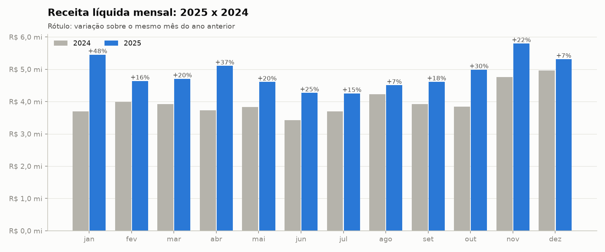
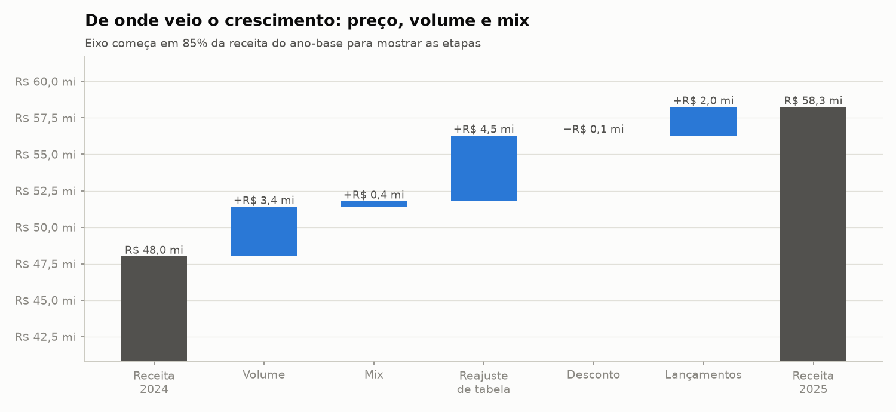
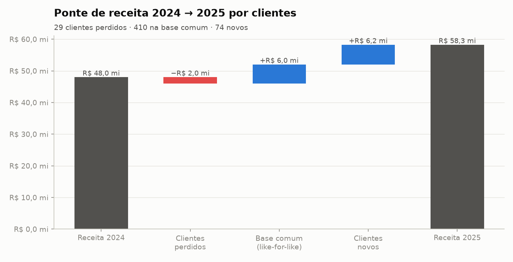
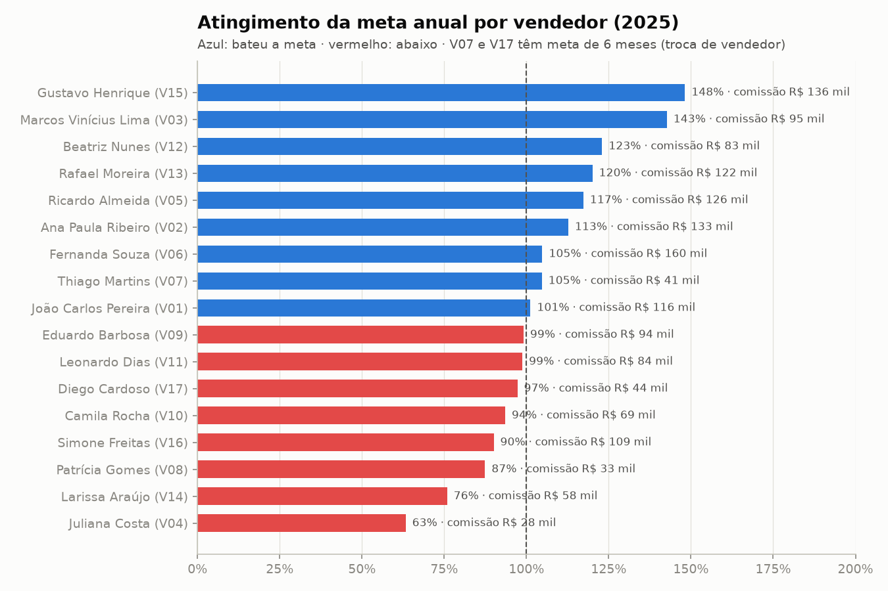
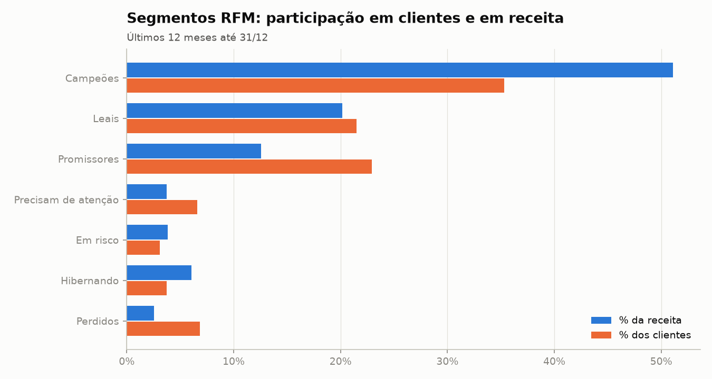
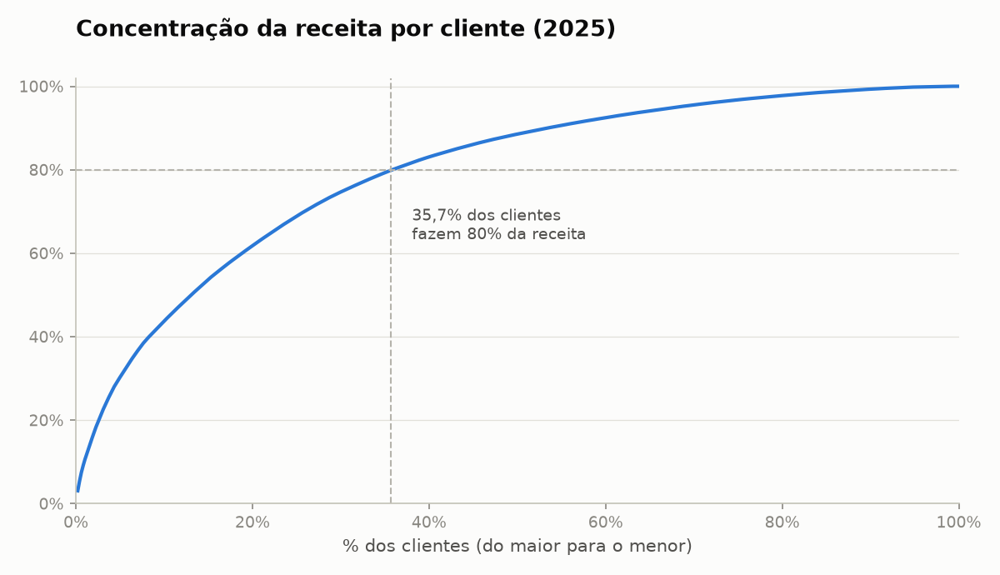
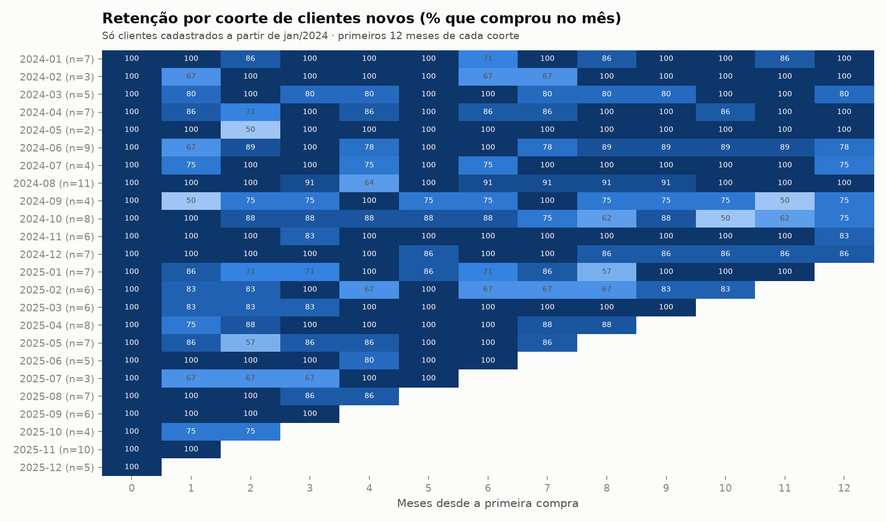

# 04 · Sales Analytics

Análise comercial de dois anos de uma distribuidora de bebidas em **Python + Pandas**.

O pipeline começa **unificando 24 arquivos mensais exportados por dois ERPs diferentes** e
termina com:
- metas contra realizado e comissões;
- crescimento ano contra ano e *like-for-like*;
- decomposição **preço × volume × mix**;
- segmentação **RFM**, **coortes de retenção** e curva de Pareto.

```text
24 CSVs mensais (2 layouts) ─┐
metas_2025.xlsx (formato largo) ─┼─ glob + detecção de layout ─ harmonização ─ fato de vendas (+ preço de tabela vigente)
cadastros (JSON/CSV) ─────────┘                                       │
                    desempenho (metas, comissões, positivação) · crescimento (YoY, ponte, PVM) · clientes (RFM, coortes, ABC)
                                                                      │
                                         validação por identidades ─ relatório · 21 CSVs · 8 gráficos
```

**Nível:** 2–3 (múltiplas fontes, transformação de schema, regras de negócio, indicadores) · **Stack:** Python 3.11+, Pandas, NumPy, openpyxl, Matplotlib, pytest

---

## Problema e contexto

A **Vértice Bebidas Distribuidora** vende cervejas, refrigerantes, águas, energéticos, sucos e
destilados para bares, restaurantes, mercados e atacados. São 16 vendedores em 4 regionais
(Capital, Grande SP, Interior e Litoral). A diretoria quer saber, ao fechar 2025:

- Quem bateu a meta e quanto cada vendedor recebe de comissão?
- Quanto crescemos, e o crescimento veio de preço, volume, mix ou produtos novos?
- O crescimento veio de clientes novos ou da base que já tínhamos?
- Quem são os melhores clientes, quem está sumindo e os clientes novos ficam?

O obstáculo: **em julho de 2024 a empresa trocou de ERP**, e os dados mudaram de formato no meio do período.

| | ERP antigo (jan–jun/2024) | ERP novo (jul/2024 em diante) |
|---|---|---|
| Arquivo | `vendas_2024-01.csv`, `;`, vírgula decimal | `vendas_2024-07.csv`, `,`, ponto decimal |
| Colunas | `data`, `nf`, `cod_vendedor`, `cod_cliente`, `sku`, `qtd`, `vlr_unit`, `vlr_desc` | `data_emissao`, `numero_nf`, `vendedor_id`, `cliente_id`, `produto_sku`, `quantidade`, `preco_unitario`, `desconto_pct`, `tipo_operacao`, `canal` |
| Vendedor | `V03`, `v03`, `3`, `v-03` | `V03` |
| Produto | SKU antigo (`CRV-015`), via de-para **incompleto** | SKU novo (`1005`) |
| Preço | **bruto** (de tabela) | **líquido** (já com desconto) |
| Desconto | **valor em R$** na linha | **percentual** |
| Devolução | quantidade negativa | `tipo_operacao = DEVOLUCAO` |
| Bonificação | preço zero | `tipo_operacao = BONIFICACAO` |
| Canal | não existia | visita · televendas · app B2B |

**Outros problemas inseridos de propósito**
- O arquivo de março/2025 foi reexportado, e há um `vendas_2025-03 (1).csv` duplicado na pasta.
- 36 linhas têm quantidades digitadas em unidades em vez de caixas, ou seja, 100x maiores.
- A planilha de metas foi feita à mão: está em **formato largo** (um mês por coluna), tem título acima do cabeçalho, usa **nomes** em vez de códigos (com e sem acento, às vezes em CAIXA ALTA), mistura números e textos como `R$ 548.000,00` e tem uma linha `TOTAL`.
- Um vendedor saiu em junho/2025, e o substituto herdou a carteira, que no cadastro continua no nome do antigo.

## Origem dos dados

Dados **sintéticos** gerados por [`scripts/generate_data.py`](scripts/generate_data.py), com semente fixa. São 650 clientes com cadastro desde 2016, 29 produtos e cerca de 144 mil linhas de venda.

O gerador simula:
- sazonalidade de verão para cervejas e águas;
- reajustes de tabela em mar/2024, out/2024 e abr/2025;
- dois lançamentos em 2025;
- churn de clientes;
- um perfil de desconto por vendedor.

As metas de 2025 são o realizado do mesmo mês de 2024 com +20%.

> Empresas, pessoas e valores são fictícios.

## Processo de tratamento — principais decisões

| Decisão | Por quê |
|---|---|
| Ler a pasta com `glob` e **detectar o layout pelo cabeçalho** | Não depende do nome do arquivo nem de uma data fixa de corte. |
| Harmonizar para quantidade sempre positiva + `tipo`, preço líquido e desconto em fração | Uma única regra de receita vale para os dois períodos. No layout antigo: `preço líquido = (qtd × preço bruto − desconto R$) / qtd`. |
| **Reconstruir o de-para pelo preço** | Dois SKUs antigos não estavam no de-para. O ERP antigo gravava o preço de tabela, então o SKU novo cujo preço vigente (`merge_asof`) bate com o praticado em ≥ 95% das linhas é o correspondente. Bateu em 100%, e nenhuma venda foi perdida. |
| Quantidade 100x detectada **em relação à mediana do cliente** | Um limite fixo de 1.000 caixas pegava só 4 de 36 erros: 300 caixas é normal num atacado e absurdo num bar que compra 3. Com o fator de 20x a mediana, foram 36 de 36. A maior razão legítima é 5x. |
| Duplicidade pela chave `nf + sku + tipo` | Remove a reexportação sem depender do nome do arquivo. |
| Metas: `melt` da planilha larga + **conferência com a linha TOTAL** | O formato longo (vendedor × mês) é o que se cruza com as vendas, e o TOTAL vira um controle. |
| Nome do vendedor cruzado por chave normalizada (sem acento, minúsculo) | `JOAO CARLOS PEREIRA` = `João Carlos Pereira`. |
| **Preço de tabela vigente** em cada venda (`merge_asof` por SKU) | Permite medir o desconto real e separar reajuste de tabela de desconto no PVM. |
| Bonificação não gera receita, mas o volume é medido | É custo comercial, não venda. |
| **Positivação** com carteira = quem comprou nos últimos 4 meses, atribuída ao vendedor da última venda | A carteira do vendedor desligado passa automaticamente para o substituto, mesmo com o cadastro desatualizado. |
| RFM: frequência e valor por **quintis**, recência por **faixas de negócio** | As recências se concentram entre 0 e 10 dias. Com quintis, um bar que comprou há 22 dias caía em "Perdidos". Com faixas (até 7, 15, 30, 60 e mais de 60 dias), "Perdidos" passa a significar 200 dias sem comprar. |
| Coortes **só com clientes cadastrados a partir de 2024** | Um cliente antigo cuja primeira compra nos dados é jan/2024 não é novo; o histórico só começa ali (censura à esquerda). |
| Retenção 0% ≠ mês não observado | A primeira versão deixava vazia a célula de um mês em que ninguém voltou, igual a um mês que ainda não decorreu. |
| Sem meta, sem comissão | A devolução lançada após o desligamento de um vendedor cria um mês com venda e sem meta. |

### Análises

| Módulo | O que calcula | Recursos de Pandas |
|---|---|---|
| [`performance.py`](src/performance.py) | atingimento mensal e acumulado, comissão por faixa, ranking e participação na regional, metas regional × categoria × trimestre, positivação, receita por dia útil, desconto médio | `pd.cut`, `cumsum` por grupo, `rank`, `transform`, `pivot_table(margins=True)`, `MultiIndex.from_product`, `rolling` e `ffill` por grupo |
| [`growth.py`](src/growth.py) | YoY por mês e dimensão com contribuição, mix por canal, ponte de clientes, **preço-volume-mix** | `pivot_table` com colunas por ano, `unstack`, `div(axis=0)` |
| [`customers.py`](src/customers.py) | RFM, coortes de retenção, Pareto/ABC | `qcut` sobre `rank`, `pd.cut`, aritmética de `Period`, `pivot_table` |

**Decomposição preço-volume-mix** (por categoria, no nível de SKU):

```text
volume = (Q₁ − Q₀) × preço médio do mix do ano-base
mix    = Q₁ × Σ (participação₁ − participação₀) × P₀
preço  = Σ Q₁ × (P₁ − P₀) = reajuste de tabela + variação de desconto
+ receita de lançamentos − receita de descontinuados
```

### Validação ([`src/validate.py`](src/validate.py))

São 16 regras **críticas**, a maioria identidades:
- a soma por regional, vendedor, categoria e segmento é igual ao total;
- o desconto informado é igual ao desconto real contra a tabela (±0,5 p.p.);
- as metas depois do `melt` batem com a linha TOTAL da planilha;
- a comissão é coerente com a faixa de atingimento;
- **os efeitos do PVM somam a variação da receita**, em cada categoria;
- a ponte de clientes fecha.

Os 5 alertas registram fatos do negócio: venda sem meta, correções feitas, de-para reconstruído, linhas da reexportação e clientes em risco.

## Arquitetura

```text
04-sales-analytics/
├── main.py                 # orquestra as 7 etapas
├── scripts/generate_data.py
├── src/
│   ├── config.py           # anos, feriados, faixas de comissão, RFM
│   ├── utils.py
│   ├── extract.py          # glob + detecção de layout · read_excel · read_json
│   ├── clean.py            # harmonização dos layouts, de-para por preço, metas (melt)
│   ├── model.py            # fato de vendas + preço de tabela (merge_asof) + calendário
│   ├── performance.py      # metas, comissões, positivação, produtividade
│   ├── growth.py           # YoY, ponte de clientes, preço-volume-mix
│   ├── customers.py        # RFM, coortes, Pareto
│   ├── validate.py         # identidades
│   └── load.py · report.py · visualize.py
├── tests/                  # 19 testes (unidade + ponta a ponta)
├── data/raw/vendas/        # 25 arquivos mensais
└── output/                 # relatorio.md · reports/ (21 CSVs) · charts/ (8 PNGs)
```

## Como executar

```bash
cd 04-sales-analytics
python3 -m venv .venv && source .venv/bin/activate   # Windows: python -m venv .venv && .venv\Scripts\activate
pip install -r requirements.txt
```

```bash
python main.py
```

```bash
pytest
```

Regenerar os dados (opcional, mesma semente):

```bash
python scripts/generate_data.py
```

A execução completa leva cerca de 2 segundos.

## Resultados obtidos

Relatório completo: [`output/relatorio.md`](output/relatorio.md).

| Indicador | Valor |
|---|---|
| Receita líquida | R$ 48,0 mi (2024) → **R$ 58,3 mi** (2025), **+21,3%** |
| Caixas vendidas em 2025 | 614.565 (+13,3%) |
| Crescimento *like-for-like* (mesmos clientes) | +13,1% |
| Meta 2025 / atingimento | R$ 57,6 mi / **101,1%** |
| Comissões apuradas | R$ 1,53 mi |
| Clientes que fazem 80% da receita | 35,7% |



### De onde veio o crescimento

| | |
|---|---|
|  |  |

- **Reajuste de tabela: +R$ 4,5 mi.** É o maior efeito, seguido do volume (+R$ 3,4 mi) e dos dois lançamentos (+R$ 2,0 mi). O mix contribuiu com +R$ 0,4 mi e o desconto quase não mudou (−R$ 0,06 mi). O crescimento foi **equilibrado entre preço e quantidade**, sem "comprar" receita com desconto.
- **Clientes:** a base comum cresceu R$ 6,0 mi (+13,1%) e os 74 clientes novos trouxeram R$ 6,2 mi, enquanto os 29 clientes perdidos tiraram R$ 2,0 mi.
- **Categorias e segmentos:** cerveja responde por 64% do crescimento, e mercados por 51%. Energético é a categoria que mais cresce (+40%).
- **Canal:** o app B2B foi de 20% para 30% da receita em um ano, ganhando espaço da visita presencial.

### Metas e comissões



- **Quem bateu:** 9 dos 17 vendedores bateram a meta anual. O atingimento vai de 63% (V04) a 148% (V15). Na matriz regional × categoria, energético passa da meta em todas as regionais e suco fica abaixo em todas.
- **Comissão x desempenho:** a Simone (V16) bateu 90% da meta e recebe **mais** comissão (R$ 109 mil) que a Beatriz (V12), que bateu 123% (R$ 83 mil). São dois motivos:
  1. A comissão é um percentual da receita, e a carteira da Simone fatura o dobro (R$ 5,7 mi contra R$ 2,8 mi).
  2. As metas copiam o mesmo mês de 2024 de cada vendedor e herdam o ruído desse ano. A meta de janeiro da Simone era R$ 257 mil (ela atingiu 257%) e a de fevereiro, R$ 740 mil (85%).
- **Recomendação:** distribuir a meta anual de cada vendedor pela sazonalidade da empresa, em vez de copiar o próprio mês do ano anterior, e avaliar a comissão por trimestre.
- **Desconto do vendedor novo:** o V17, que assumiu a carteira do V07 em julho, concede **10,4% de desconto médio**, contra 5,4% do antecessor. Esse ponto merece acompanhamento.

### Clientes

| | |
|---|---|
|  |  |

- **Concentração:** os **Campeões** (35% dos clientes) fazem 51% da receita.
- **Em risco:** 15 clientes de alta frequência estão há 75 dias sem comprar e somaram R$ 2,2 mi nos últimos 12 meses. A lista está em [`clientes_em_risco.csv`](output/reports/clientes_em_risco.csv).
- **Retenção:** quem começa a comprar costuma ficar. Nos primeiros 12 meses, cerca de 85% a 95% dos clientes de cada coorte compram a cada mês. Por outro lado, as coortes são pequenas (2 a 11 clientes por mês), o que deixa os números voláteis.
- **Positivação:** em média, 88% da carteira ativa compra todo mês.



## Próximas evoluções

- Metas sazonalizadas pela curva da empresa e simulação do impacto em comissões.
- Margem por SKU (custo do produto) para avaliar o mix pela rentabilidade, não só pela receita.
- Previsão de vendas com sazonalidade e alerta automático de clientes que saem do padrão de compra.
- Carga incremental mensal em banco SQL (projetos 10–12).
