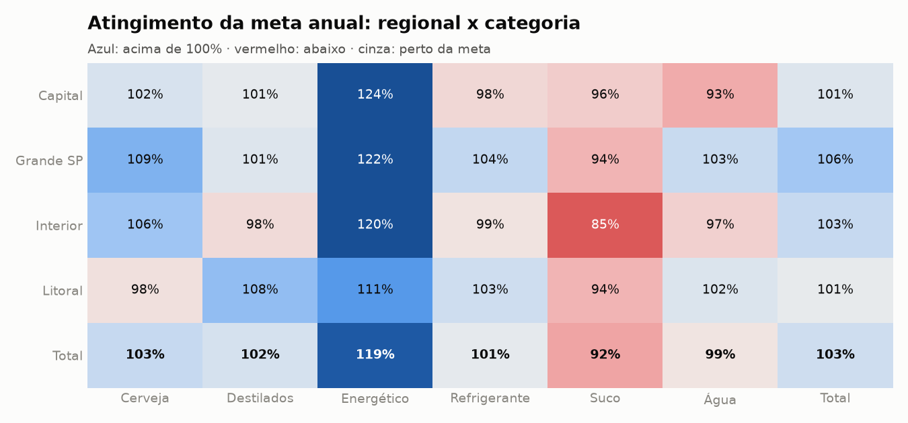

# Análise comercial 2025

_Gerado automaticamente por `python main.py`._

## 1. Indicadores

| Indicador | Valor |
|---|---|
| Receita líquida 2024 | R$ 48,02 mi |
| Receita líquida 2025 | R$ 58,26 mi (21,3%) |
| Caixas vendidas 2025 | 614.565 (13,3%) |
| Crescimento like-for-like (base comum de clientes) | 13,1% |
| Ticket médio por nota 2025 | R$ 3.203,01 |
| Clientes com compra em 2025 | 484 |
| Meta 2025 | R$ 57,61 mi |
| Atingimento da meta | 101,1% |
| Comissões apuradas | R$ 1.527.701,09 |
| Caixas bonificadas | 9.339 |
| Clientes que fazem 80% da receita | 35,7% |

## 2. Metas x realizado

| vendedor_id | nome | regional | meta | realizado | atingimento | meses_meta_batida | comissao | desconto_medio | ranking_regional |
|---|---|---|---|---|---|---|---|---|---|
| V03 | Marcos Vinícius Lima | Capital | 1.801.000,000 | 2.569.544,290 | 1,427 | 11 | 94.610,120 | 0,044 | 1 |
| V02 | Ana Paula Ribeiro | Capital | 3.814.000,000 | 4.298.568,980 | 1,127 | 7 | 132.584,550 | 0,093 | 2 |
| V01 | João Carlos Pereira | Capital | 4.124.000,000 | 4.174.105,920 | 1,012 | 7 | 116.210,770 | 0,080 | 3 |
| V04 | Juliana Costa | Capital | 3.619.000,000 | 2.289.841,420 | 0,633 | 3 | 27.513,630 | 0,060 | 4 |
| V05 | Ricardo Almeida | Grande SP | 3.283.000,000 | 3.850.748,600 | 1,173 | 11 | 125.749,490 | 0,032 | 1 |
| V06 | Fernanda Souza | Grande SP | 5.330.000,000 | 5.587.152,760 | 1,048 | 6 | 159.539,100 | 0,065 | 2 |
| V07 | Thiago Martins | Grande SP | 1.422.000,000 | 1.488.348,650 | 1,047 | 3 | 41.042,020 | 0,054 | 3 |
| V17 | Diego Cardoso | Grande SP | 1.973.000,000 | 1.918.670,470 | 0,973 | 3 | 43.753,500 | 0,104 | 4 |
| V08 | Patrícia Gomes | Grande SP | 1.744.000,000 | 1.524.208,200 | 0,874 | 4 | 33.427,690 | 0,027 | 5 |
| V12 | Beatriz Nunes | Interior | 2.278.000,000 | 2.801.674,210 | 1,230 | 8 | 82.897,750 | 0,066 | 1 |
| V09 | Eduardo Barbosa | Interior | 4.100.000,000 | 4.064.094,270 | 0,991 | 5 | 94.409,930 | 0,076 | 2 |
| V11 | Leonardo Dias | Interior | 3.220.000,000 | 3.180.296,250 | 0,988 | 6 | 83.668,300 | 0,076 | 3 |
| V10 | Camila Rocha | Interior | 3.620.000,000 | 3.385.733,050 | 0,935 | 4 | 68.718,830 | 0,059 | 4 |
| V15 | Gustavo Henrique | Litoral | 2.451.000,000 | 3.631.560,090 | 1,482 | 11 | 135.983,940 | 0,064 | 1 |
| V13 | Rafael Moreira | Litoral | 3.049.000,000 | 3.659.982,530 | 1,200 | 10 | 121.525,120 | 0,062 | 2 |
| V16 | Simone Freitas | Litoral | 6.311.000,000 | 5.681.936,540 | 0,900 | 3 | 108.546,290 | 0,071 | 3 |
| V14 | Larissa Araújo | Litoral | 5.474.000,000 | 4.152.993,570 | 0,759 | 3 | 57.520,060 | 0,073 | 4 |

### Atingimento por regional x categoria

| regional | Cerveja | Destilados | Energético | Refrigerante | Suco | Água | Total |
|---|---|---|---|---|---|---|---|
| Capital | 1,019 | 1,009 | 1,241 | 0,975 | 0,961 | 0,927 | 1,015 |
| Grande SP | 1,086 | 1,015 | 1,215 | 1,036 | 0,935 | 1,032 | 1,062 |
| Interior | 1,065 | 0,978 | 1,204 | 0,986 | 0,850 | 0,967 | 1,034 |
| Litoral | 0,984 | 1,075 | 1,114 | 1,028 | 0,935 | 1,017 | 1,007 |
| Total | 1,034 | 1,021 | 1,187 | 1,008 | 0,921 | 0,988 | 1,028 |

### Positivação da carteira (vendedor x mês)

| vendedor_id | 1 | 2 | 3 | 4 | 5 | 6 | 7 | 8 | 9 | 10 | 11 | 12 |
|---|---|---|---|---|---|---|---|---|---|---|---|---|
| V01 | 0,926 | 0,815 | 0,852 | 0,964 | 0,893 | 0,786 | 0,893 | 0,893 | 0,893 | 0,929 | 0,821 | 0,815 |
| V02 | 0,897 | 0,828 | 0,897 | 0,931 | 0,931 | 0,897 | 0,897 | 0,900 | 0,900 | 0,933 | 0,871 | 1,000 |
| V03 | 0,931 | 0,897 | 0,833 | 0,967 | 0,867 | 0,933 | 0,806 | 0,936 | 0,875 | 0,844 | 0,844 | 0,936 |
| V04 | 0,846 | 0,769 | 0,808 | 0,720 | 0,792 | 0,792 | 0,773 | 0,818 | 0,826 | 0,875 | 1,000 | 0,917 |
| V05 | 0,966 | 0,967 | 0,933 | 0,900 | 0,900 | 0,903 | 0,903 | 0,900 | 0,933 | 0,933 | 0,966 | 0,897 |
| V06 | 0,971 | 0,914 | 0,857 | 0,914 | 0,943 | 0,833 | 0,889 | 0,806 | 0,853 | 0,914 | 0,886 | 0,889 |
| V07 | 0,923 | 0,889 | 0,852 | 0,893 | 0,893 | 0,897 | 0,000 | 0,000 |  |  |  |  |
| V08 | 0,875 | 0,792 | 0,833 | 0,826 | 0,833 | 0,833 | 0,667 | 0,826 | 0,954 | 0,870 | 0,913 | 0,833 |
| V09 | 1,000 | 0,885 | 0,885 | 0,885 | 0,923 | 0,920 | 0,880 | 0,923 | 0,880 | 0,846 | 0,769 | 0,769 |
| V10 | 0,889 | 0,963 | 1,000 | 0,963 | 0,893 | 0,893 | 0,929 | 0,750 | 0,964 | 0,929 | 0,893 | 0,964 |
| V11 | 0,875 | 0,960 | 0,958 | 0,880 | 0,960 | 0,923 | 0,962 | 0,926 | 1,000 | 0,893 | 0,964 | 0,966 |
| V12 | 0,864 | 0,913 | 0,864 | 0,909 | 0,875 | 0,958 | 0,833 | 0,840 | 0,840 | 0,720 | 0,885 | 0,923 |
| V13 | 0,900 | 1,000 | 0,905 | 0,952 | 0,762 | 0,857 | 0,864 | 0,905 | 0,818 | 0,956 | 0,958 | 0,917 |
| V14 | 1,000 | 0,931 | 0,828 | 0,900 | 0,900 | 0,806 | 0,839 | 0,897 | 0,931 | 0,966 | 0,967 | 0,900 |
| V15 | 0,846 | 0,880 | 0,815 | 0,857 | 0,741 | 0,920 | 0,923 | 0,962 | 0,808 | 0,885 | 0,962 | 0,923 |
| V16 | 0,926 | 0,963 | 0,929 | 0,897 | 0,897 | 0,931 | 0,828 | 0,875 | 0,824 | 0,970 | 0,882 | 0,971 |
| V17 |  |  |  |  |  |  | 1,000 | 0,931 | 0,833 | 0,903 | 0,936 | 1,000 |

## 3. Crescimento 2025 x 2024

| mes | receita_2024 | receita_2025 | caixas_2024 | caixas_2025 | var_receita_pct | var_caixas_pct |
|---|---|---|---|---|---|---|
| 1 | 3.691.487,36 | 5.454.176,60 | 44.922 | 59.842 | 47,75 | 33,21 |
| 2 | 3.987.107,11 | 4.639.360,20 | 49.557 | 52.665 | 16,36 | 6,27 |
| 3 | 3.927.562,86 | 4.707.273,57 | 44.590 | 52.542 | 19,85 | 17,83 |
| 4 | 3.735.634,16 | 5.105.170,79 | 41.822 | 52.853 | 36,66 | 26,38 |
| 5 | 3.837.608,44 | 4.607.694,42 | 42.781 | 45.955 | 20,07 | 7,42 |
| 6 | 3.423.630,27 | 4.271.838,24 | 37.900 | 44.013 | 24,78 | 16,13 |
| 7 | 3.692.199,32 | 4.254.131,73 | 41.516 | 43.597 | 15,22 | 5,01 |
| 8 | 4.230.780,40 | 4.506.956,62 | 46.594 | 47.036 | 6,53 | 0,95 |
| 9 | 3.922.167,46 | 4.612.830,95 | 45.149 | 47.412 | 17,61 | 5,01 |
| 10 | 3.844.026,33 | 4.988.221,23 | 42.574 | 51.632 | 29,77 | 21,28 |
| 11 | 4.761.431,36 | 5.798.255,11 | 52.161 | 61.174 | 21,78 | 17,28 |
| 12 | 4.962.398,75 | 5.313.550,34 | 53.024 | 55.844 | 7,08 | 5,32 |

| categoria | receita_2024 | receita_2025 | variacao | var_pct | contribuicao_pct |
|---|---|---|---|---|---|
| Cerveja | 29.713.611,60 | 36.258.309,18 | 6.544.697,58 | 22,03 | 63,89 |
| Destilados | 9.115.174,45 | 10.985.124,59 | 1.869.950,14 | 20,51 | 18,26 |
| Refrigerante | 5.040.014,28 | 5.993.305,97 | 953.291,69 | 18,91 | 9,31 |
| Energético | 1.421.983,62 | 1.989.936,97 | 567.953,35 | 39,94 | 5,54 |
| Suco | 1.825.103,69 | 1.983.833,75 | 158.730,06 | 8,70 | 1,55 |
| Água | 900.146,18 | 1.048.949,34 | 148.803,16 | 16,53 | 1,45 |

| segmento | receita_2024 | receita_2025 | variacao | var_pct | contribuicao_pct |
|---|---|---|---|---|---|
| Mercado | 18.980.890,47 | 24.234.981,62 | 5.254.091,15 | 27,68 | 51,29 |
| Atacado | 18.723.195,09 | 21.974.929,53 | 3.251.734,44 | 17,37 | 31,74 |
| Bar | 7.945.496,69 | 9.397.461,47 | 1.451.964,78 | 18,27 | 14,17 |
| Restaurante | 2.366.451,57 | 2.652.087,18 | 285.635,61 | 12,07 | 2,79 |

### Ponte de receita por clientes

| etapa | valor | clientes | like_for_like_pct |
|---|---|---|---|
| Receita 2024 | 48.016.033,82 | 439 |  |
| Clientes perdidos | -2.005.078,80 | 29 |  |
| Variação na base comum | 6.015.206,39 | 410 | 13,07 |
| Clientes novos | 6.233.298,39 | 74 |  |
| Receita 2025 | 58.259.459,80 | 484 |  |

### Preço, volume e mix

| categoria | receita_base | receita_atual | volume | mix | preco_tabela | preco_desconto | lancamentos | descontinuados | variacao | soma_dos_efeitos |
|---|---|---|---|---|---|---|---|---|---|---|
| Cerveja | 29.713.611,60 | 36.258.309,18 | 2.058.415,84 | 114.163,46 | 2.645.162,62 | -21.350,00 | 1.748.305,66 | 0,00 | 6.544.697,58 | 6.544.697,58 |
| Destilados | 9.115.174,45 | 10.985.124,59 | 671.704,93 | 265.766,39 | 971.673,85 | -39.195,03 | 0,00 | 0,00 | 1.869.950,14 | 1.869.950,14 |
| Energético | 1.421.983,62 | 1.989.936,97 | 161.399,15 | 3.484,37 | 140.789,80 | -2.818,72 | 265.098,75 | 0,00 | 567.953,35 | 567.953,35 |
| Refrigerante | 5.040.014,28 | 5.993.305,97 | 461.846,10 | 52,53 | 491.928,04 | -534,97 | 0,00 | 0,00 | 953.291,69 | 953.291,69 |
| Suco | 1.825.103,69 | 1.983.833,75 | -21.967,57 | -3.108,04 | 175.664,69 | 8.140,97 | 0,00 | 0,00 | 158.730,06 | 158.730,06 |
| Água | 900.146,18 | 1.048.949,34 | 67.208,67 | 1.870,82 | 80.364,84 | -641,17 | 0,00 | 0,00 | 148.803,16 | 148.803,16 |
| Total | 48.016.033,82 | 58.259.459,80 | 3.398.607,12 | 382.229,53 | 4.505.583,84 | -56.398,92 | 2.013.404,41 | 0,00 | 10.243.425,98 | 10.243.425,98 |

### Mix por canal (% da receita)

| mes | app_b2b | televendas | visita |
|---|---|---|---|
| 2024-07 | 19,8 | 24,6 | 55,6 |
| 2024-08 | 19,8 | 26,0 | 54,2 |
| 2024-09 | 18,8 | 24,6 | 56,6 |
| 2024-10 | 19,3 | 23,2 | 57,5 |
| 2024-11 | 20,2 | 25,2 | 54,5 |
| 2024-12 | 19,9 | 23,8 | 56,3 |
| 2025-01 | 30,7 | 24,5 | 44,7 |
| 2025-02 | 30,3 | 26,0 | 43,7 |
| 2025-03 | 29,2 | 23,5 | 47,3 |
| 2025-04 | 30,7 | 23,5 | 45,8 |
| 2025-05 | 28,0 | 25,6 | 46,4 |
| 2025-06 | 28,2 | 25,5 | 46,3 |
| 2025-07 | 28,5 | 27,7 | 43,8 |
| 2025-08 | 29,6 | 27,0 | 43,5 |
| 2025-09 | 31,2 | 24,8 | 44,0 |
| 2025-10 | 31,1 | 23,5 | 45,5 |
| 2025-11 | 32,0 | 24,8 | 43,2 |
| 2025-12 | 30,4 | 26,6 | 43,0 |

## 4. Clientes

| segmento_rfm | clientes | receita | recencia_media | frequencia_media | ticket_anual_medio | pct_clientes | pct_receita |
|---|---|---|---|---|---|---|---|
| Campeões | 171 | 29.766.787,79 | 4,39 | 57,42 | 174.074,78 | 35,33 | 51,09 |
| Leais | 104 | 11.747.743,69 | 9,91 | 33,99 | 112.959,07 | 21,49 | 20,16 |
| Promissores | 111 | 7.318.998,13 | 5,81 | 17,25 | 65.936,92 | 22,93 | 12,56 |
| Precisam de atenção | 32 | 2.158.965,35 | 22,44 | 16,84 | 67.467,67 | 6,61 | 3,71 |
| Em risco | 15 | 2.244.276,21 | 75,47 | 42,60 | 149.618,41 | 3,10 | 3,85 |
| Hibernando | 18 | 3.532.316,09 | 42,78 | 14,44 | 196.239,78 | 3,72 | 6,06 |
| Perdidos | 33 | 1.490.372,54 | 201,52 | 11,79 | 45.162,80 | 6,82 | 2,56 |

### Clientes em risco (ligar hoje)

| cliente_id | recencia_dias | frequencia | valor | R | F | M | segmento_rfm | segmento | regional | vendedor_id |
|---|---|---|---|---|---|---|---|---|---|---|
| CLI-0095 | 205 | 30 | 748.924,17 | 1 | 3 | 5 | Em risco | Atacado | Litoral | V16 |
| CLI-0086 | 154 | 75 | 286.057,34 | 1 | 5 | 5 | Em risco | Mercado | Interior | V12 |
| CLI-0395 | 153 | 46 | 177.797,01 | 1 | 4 | 4 | Em risco | Mercado | Grande SP | V06 |
| CLI-0015 | 44 | 44 | 155.476,92 | 2 | 4 | 4 | Em risco | Mercado | Capital | V03 |
| CLI-0052 | 34 | 35 | 131.704,18 | 2 | 3 | 4 | Em risco | Mercado | Litoral | V13 |
| CLI-0231 | 40 | 30 | 124.468,05 | 2 | 3 | 4 | Em risco | Mercado | Interior | V09 |
| CLI-0538 | 36 | 34 | 110.610,28 | 2 | 3 | 4 | Em risco | Mercado | Capital | V04 |
| CLI-0227 | 33 | 30 | 102.076,17 | 2 | 3 | 4 | Em risco | Mercado | Grande SP | V05 |
| CLI-0294 | 33 | 73 | 90.954,51 | 2 | 5 | 4 | Em risco | Bar | Litoral | V15 |
| CLI-0008 | 43 | 52 | 70.928,05 | 2 | 5 | 3 | Em risco | Bar | Grande SP | V05 |
| CLI-0535 | 154 | 37 | 55.742,90 | 1 | 4 | 3 | Em risco | Bar | Capital | V03 |
| CLI-0480 | 92 | 45 | 53.000,05 | 1 | 4 | 3 | Em risco | Bar | Interior | V09 |
| CLI-0465 | 40 | 43 | 49.314,35 | 2 | 4 | 3 | Em risco | Restaurante | Litoral | V14 |
| CLI-0624 | 34 | 34 | 49.224,47 | 2 | 3 | 3 | Em risco | Bar | Interior | V11 |
| CLI-0107 | 37 | 31 | 37.997,76 | 2 | 3 | 2 | Em risco | Bar | Grande SP | V06 |

### Retenção por coorte

| mes_relativo | retencao_media | coortes_observadas |
|---|---|---|
| 0 | 1,000 | 24 |
| 1 | 0,880 | 23 |
| 2 | 0,871 | 22 |
| 3 | 0,914 | 21 |
| 4 | 0,877 | 20 |
| 5 | 0,965 | 19 |
| 6 | 0,893 | 18 |
| 7 | 0,878 | 17 |
| 8 | 0,850 | 16 |
| 9 | 0,924 | 15 |
| 10 | 0,895 | 14 |
| 11 | 0,900 | 13 |
| 12 | 0,877 | 12 |
| 13 | 0,894 | 11 |
| 14 | 0,867 | 10 |
| 15 | 0,827 | 9 |
| 16 | 0,896 | 8 |
| 17 | 0,919 | 7 |
| 18 | 0,879 | 6 |
| 19 | 0,833 | 5 |
| 20 | 0,818 | 4 |
| 21 | 0,733 | 3 |
| 22 | 0,500 | 2 |
| 23 | 0,714 | 1 |

### Concentração da receita

## 5. Controles e validações

| mes | total_planilha | soma_apos_melt | diferenca |
|---|---|---|---|
| Jan | 4.428.000,00 | 4.428.000,00 | 0,00 |
| Fev | 4.786.000,00 | 4.786.000,00 | 0,00 |
| Mar | 4.714.000,00 | 4.714.000,00 | 0,00 |
| Abr | 4.481.000,00 | 4.481.000,00 | 0,00 |
| Mai | 4.602.000,00 | 4.602.000,00 | 0,00 |
| Jun | 4.107.000,00 | 4.107.000,00 | 0,00 |
| Jul | 4.429.000,00 | 4.429.000,00 | 0,00 |
| Ago | 5.078.000,00 | 5.078.000,00 | 0,00 |
| Set | 4.707.000,00 | 4.707.000,00 | 0,00 |
| Out | 4.612.000,00 | 4.612.000,00 | 0,00 |
| Nov | 5.714.000,00 | 5.714.000,00 | 0,00 |
| Dez | 5.955.000,00 | 5.955.000,00 | 0,00 |

| grupo | regra | severidade | ocorrencias | passou |
|---|---|---|---|---|
| modelo | toda linha tem SKU, categoria, cliente e segmento | critica | 0 | sim |
| modelo | toda linha tem preço de tabela vigente | critica | 0 | sim |
| modelo | quantidade positiva | critica | 0 | sim |
| modelo | preço praticado não acima da tabela | critica | 0 | sim |
| modelo | desconto informado = desconto real (±0,5 p.p.) | critica | 0 | sim |
| agregações | soma por regional = receita total | critica | 0 | sim |
| agregações | soma por vendedor_id = receita total | critica | 0 | sim |
| agregações | soma por categoria = receita total | critica | 0 | sim |
| agregações | soma por segmento = receita total | critica | 0 | sim |
| agregações | realizado de metas x realizado = receita total | critica | 0 | sim |
| metas | soma das metas após melt = linha TOTAL da planilha | critica | 0 | sim |
| metas | comissão coerente com a faixa de atingimento | critica | 0 | sim |
| crescimento | PVM: soma dos efeitos = variação da receita (por categoria) | critica | 0 | sim |
| crescimento | ponte de clientes fecha (início + etapas = fim) | critica | 0 | sim |
| clientes | notas RFM entre 1 e 5 | critica | 0 | sim |
| clientes | retenção no mês 0 = 100% | critica | 0 | sim |
| metas | vendedor-mês com venda e sem meta | alerta | 1 | não |
| dados | quantidades corrigidas (digitadas 100x) | alerta | 36 | não |
| dados | SKUs antigos com de-para reconstruído pelo preço | alerta | 2 | não |
| dados | linhas descartadas por reexportação duplicada | alerta | 6.462 | não |
| clientes | clientes em risco (RFM) com histórico frequente | alerta | 15 | não |
